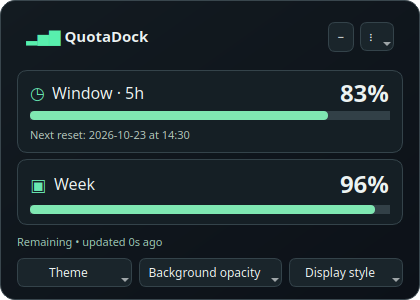
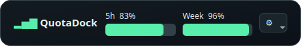

# QuotaDock

**Your remaining Codex quota, always within reach.**

QuotaDock is a lightweight desktop companion for Linux and Windows that shows your real remaining Codex quota in a compact overlay anchored to the active ChatGPT/Codex window, with a live system-tray icon. It keeps usage visible without opening the usage settings after every action.

It reads server-reported percentages from the local Codex app server. It does not count messages or estimate token consumption.

### Dashboard preview

The screenshots use demo percentages for illustration; normal operation always displays server-reported quota.





## Features

- **Real remaining quota:** percentages from 100% down to 0% for your short-term and weekly windows.
- **Live tray icon:** remaining percentage and proportional quota bars, with full values available on hover.
- **Automatic quota refresh:** accepts quota notifications immediately and uses periodic polling as a safety net.
- **Safe retries:** reconnects with a capped exponential delay and jitter when the local service is unavailable.
- **Next reset time:** visible below the hours panel, in your computer's local time zone.
- **Compact bar theme:** shows only the remaining percentage and its progress bar, with no app name or labels.
- **ChatGPT/Codex-only overlay:** by default the small pop-up stays inside the active ChatGPT/Codex window and hides when you switch to another app.
- **QuotaDock app icon:** a custom quota-meter icon appears in the application menu. The floating window is hidden from the taskbar by default while the system tray keeps its live usage indicator.
- **Choose your panels:** hours only, weekly only, or both.
- **Solid or translucent theme:** three background opacity levels, with readable opaque text.
- **Dashboard theme:** dark bordered quota cards, mint progress bars and a compact strip with both quota windows, inspired by a desktop dashboard layout.
- **Move and resize:** drag the title to move and the edges or corners to resize.
- **Saved preferences:** position, dimensions, theme and visible panels persist between sessions.
- **Language:** English by default; switch to Portuguese in the settings menu without restarting.
- **Optional login startup:** installs a desktop menu shortcut and can start automatically at login.
- **Honest offline state:** missing values appear as `—`; stale data is grayed out and the tray icon shows `?`.

## Compatibility

The Linux version has been tested on **Kubuntu 26.04, KDE Plasma, Wayland with XWayland**. A Windows port is available for **Windows 10/11**, Python 3 and PySide6; it uses the native Win32 foreground-window APIs and needs validation on a Windows computer. macOS is not supported.

QuotaDock is a standalone companion, **not a plugin injected into ChatGPT**. By default it anchors its pop-up to the active ChatGPT/Codex window and hides when that window loses focus. On Linux this uses `xprop` and `xwininfo`; on Windows it recognizes foreground windows owned by `ChatGPT.exe` or `Codex.exe`. If no matching window is detectable, the overlay stays hidden. Turn off **Show only over ChatGPT/Codex** in the tray menu to use it as a regular floating window. It does not modify the official application.

The displayed quota belongs to the account authenticated in the **local Codex runtime**. It is not a universal meter for every model or feature in regular ChatGPT chats. Some plans may omit one of the quota windows.

| Platform | Status | Notes |
| --- | --- | --- |
| Kubuntu/KDE with XWayland | Supported beta | Primary development environment. |
| Other Linux desktops | Community beta | Uses a normal floating-window fallback if active-window tracking is unavailable. |
| Windows 10/11 | Supported beta | CI and installer are tested; DPI and multi-monitor validation on physical hardware remains in progress. |
| macOS | Not supported | No foreground-window adapter yet. |

Manual hardware validation is tracked in the [platform checklist](docs/platform-validation.md).

## Quick start — Ubuntu / Kubuntu

1. Install and sign in to ChatGPT/Codex. QuotaDock needs a local Codex executable with an authenticated ChatGPT account.
2. Install the UI dependency:

   ```sh
   sudo apt install python3-pyside6.qtwidgets
   ```

3. Download this repository using **Code → Download ZIP** and extract it. Open a terminal in the extracted folder and run:

   ```sh
   sh install.sh
   ```

4. Open **QuotaDock** from your application menu. Your quota loads automatically.

The installer runs as your normal user; do **not** run it with `sudo`. It creates a desktop shortcut and enables startup at login. To install without startup at login:

```sh
sh install.sh --no-autostart
```

For a checkout with Git:

```sh
git clone https://github.com/sakazaki1/quotadock.git
cd quotadock
sh install.sh
```

To try QuotaDock without installing:

```sh
sh launch.sh
```

## Quick start — Windows 10/11

1. Install Python 3 from [python.org](https://www.python.org/downloads/windows/) with the Python launcher (`py`). Install and sign in to the ChatGPT/Codex desktop app or Codex CLI so `codex.exe` is available.
2. Download this repository using **Code → Download ZIP** and extract it.
3. Double-click `install-windows.cmd`. It creates a per-user Python environment, installs PySide6, and adds **QuotaDock** to the Start menu and Startup folder. No administrator rights are needed. Internet access is needed once for PySide6.
4. Launch **QuotaDock** from the Start menu. The usage indicator appears in the Windows notification area; Windows may initially place it behind the hidden-icons arrow.

To disable startup at login, run `install-windows.cmd --no-autostart` from Command Prompt. Quit QuotaDock before updating, then run the installer from a newly downloaded copy. The installed files live in `%LOCALAPPDATA%\QuotaDock` and the shortcuts in your user Start menu. To remove it, quit the app, delete that folder and the two `QuotaDock.lnk` shortcuts from your Start menu and Startup folder.

The Windows overlay currently recognizes desktop processes named `ChatGPT.exe` and `Codex.exe`. If your app uses another executable name, turn off **Show only over ChatGPT/Codex** in the tray menu. Window anchoring, DPI scaling and multi-monitor behavior still need validation on Windows hardware.

### Codex executable discovery

QuotaDock looks for Codex bundled with common Linux ChatGPT/Codex installations, then checks `codex` on your `PATH`. If it cannot find your executable, launch it with an explicit path:

```sh
QUOTADOCK_CODEX=/path/to/codex sh launch.sh
```

On Windows it checks common per-user desktop locations and `codex.exe` on `PATH`. You can set `QUOTADOCK_CODEX` to the full path of a trusted `codex.exe` in your user environment and relaunch QuotaDock. A Windows desktop installation may not bundle an executable at the locations QuotaDock checks; the Codex CLI is another option.

To use this override from the application menu as well, configure the environment variable in your desktop session. Sign in using your Codex installation's normal sign-in flow. QuotaDock never asks you to paste credentials or API keys.

`QUOTADOCK_CODEX` and your `PATH` must point to a Codex executable you trust. On POSIX, QuotaDock rejects executables writable by group or other users and accepts only files owned by you or root. It never prints its environment, protocol responses or authentication data to a log.

## Everyday controls

| Control | Action |
| --- | --- |
| Drag the title | Move the floating window |
| Drag any edge or corner | Resize the window; compact and full window sizes are saved separately |
| **−** | Hide the floating window while the tray indicator continues to update |
| Left-click the tray icon | Show or hide the window |
| **QuotaDock on GitHub** | Open the public repository |
| Right-click the tray icon / **⋮** | Open the settings menu |
| **Minimal interface** | Switch compact/detailed layout |
| **Display style → Bar and percentage only** | Hide the title and labels and show a small usage bar with its remaining percentage; drag the bar to move it and right-click for options |
| **Display style → Full window** | Leave minimal mode and restore the full quota panel |
| **Show only over ChatGPT/Codex** | Keep the pop-up inside the active ChatGPT/Codex window and hide it elsewhere |
| **Copy Codex executable path** | Copy the resolved local Codex path for troubleshooting |
| **Visible panels** | Select hours, weekly, or both |
| **Theme** | Choose solid or translucent; adjust background opacity |
| **Theme → Dashboard** | Use the redesigned dark cards; in compact mode this opens the two-window dashboard strip |
| **Display style → Dashboard strip** | Show hours and weekly usage together in a movable, resizable strip |
| **Language** | Switch between English and Português; the choice is saved |
| **Refresh now** | Request an immediate reading |
| **Quit** | Stop QuotaDock and its helper process |

With both panels selected, the tray number represents the hours window; the top strip represents hours and the lower strip represents the weekly window. With weekly only, the number represents the weekly window. Hover for the complete percentages and reset time. The short-term window label follows the actual duration returned by Codex; it is not hardcoded to five hours.

## Accuracy and privacy

QuotaDock starts `codex app-server --stdio`, completes initialization, and calls the documented `account/rateLimits/read` method. Remaining quota is calculated as `100 - usedPercent`. It also accepts `account/rateLimits/updated` notifications on that connection.

Updates are periodic, not guaranteed after every individual action. A request may wait up to 20 seconds before timing out. Failed connections retry with a capped exponential delay and jitter, avoiding repeated rapid launches when the runtime is unavailable. The service itself can delay reporting. QuotaDock does not predict resets or synthesize new percentages when the local clock reaches a reset time. When offline, the window retains the last reading in gray with a warning; the tray switches to `?`. Readings older than 75 seconds are marked stale.

- No analytics, ad services or QuotaDock backend.
- No direct reading, copying or transmission of authentication files by QuotaDock.
- No prompt submission, conversation collection, credit purchases or reset consumption.
- The Codex helper uses its own existing authentication and contacts OpenAI under the runtime's normal configuration. QuotaDock has no separate API key requirement.
- Only UI preferences are stored by QuotaDock, normally in `~/.config/QuotaDock/QuotaDock.conf`. The Codex runtime may maintain its own files independently.
- Switching accounts in the main application may require restarting QuotaDock so its helper reconnects with the current local authentication.

QuotaDock is an independent community project and is not affiliated with or endorsed by OpenAI. ChatGPT and Codex are trademarks of their respective owners.

## Troubleshooting

**No percentage appears:** check your Codex sign-in and executable location. Missing or inaccessible quota is shown as unavailable rather than 100%.

**Cannot move or resize the compact bar:** drag its center to move, drag a narrow edge to resize, or right-click it to open the menu. In full-window mode, drag the title to move and any edge or corner to resize. On KDE Wayland, the launcher uses XWayland when available; check for custom KWin window rules if the compositor blocks these actions.

**Window is hidden:** click the tray icon, or use its right-click menu → **Show / hide QuotaDock**. Use **Reset window position** if it is offscreen. Without a system tray, minimizing falls back to a regular taskbar entry.

**Multiple launches:** only one instance is allowed per desktop session. Use the existing tray icon to restore it.

**Disable login startup:** open your desktop's Autostart settings and disable QuotaDock, or reinstall using `--no-autostart`.

## Update

To update, quit QuotaDock from its tray menu, download the new version, run `sh install.sh` again, then reopen it from the menu. Reuse `--no-autostart` if you want startup disabled.

Tagged versions publish standalone Linux and Windows packages in [GitHub Releases](https://github.com/sakazaki1/quotadock/releases). A Python package definition is also included, so developers can install a checkout in an isolated environment with `pipx install .`.

## Claude Code usage — optional, can run next to Codex

QuotaDock can show your Claude plan usage (the 5-hour and 7-day windows) without browser cookies, tokens or unofficial web endpoints. Claude Code hands these numbers only to its status-line command, so a small standard-library helper mirrors them into a local file that QuotaDock reads.

1. Point Claude Code at the helper in `~/.claude/settings.json` (after `pipx install .` the command is `quotadock-claude-mirror`):

   ```json
   { "statusLine": { "type": "command", "command": "python3 ~/.local/share/quotadock/claude_statusline_mirror.py" } }
   ```

   Already have a status line? Keep it by chaining it: add `--then '~/.claude/my-statusline.sh'` to the command. It receives the same input and its output is what Claude Code displays.
2. Launch Claude alone, or Codex and Claude together:

   ```sh
   quotadock --source claude-file                       # file defaults to ~/.claude/statusline-state.json
   quotadock --source both                              # one process, one window and tray icon per provider
   quotadock --source both --claude-state /other/state.json
   ```

   `sh install.sh --with-claude` makes the application-menu and login shortcuts start both.

What to expect:

- Each provider has its own window, tray icon (Claude's has an orange stripe), position, theme and alerts. Only the interface language is shared.
- The numbers refresh when Claude Code renders its status line, so they are as recent as your last Claude Code activity. They exist only for subscription plans and appear after the first response of a session; API-key accounts have none.
- A window whose reset time has passed is shown as `—`, never as its old value and never as an assumed 0%.
- Anchoring the overlay to an application window is Codex-only. The Claude window is a regular floating window.
- QuotaDock only sees what Claude Code reports. There is no supported local source for the Claude web or desktop apps.

## Uninstall

To uninstall, quit QuotaDock and run:

```sh
python3 ~/.local/share/quotadock/uninstall.py
```

The uninstaller respects custom `XDG_DATA_HOME` and `XDG_CONFIG_HOME` settings. With a custom data directory, run the uninstaller from that directory instead. It removes only QuotaDock's installation, shortcuts and UI preferences, leaving ChatGPT/Codex and its authentication untouched.

## Development

```sh
python3 -m unittest discover -s . -p 'test_*.py'
QT_QPA_PLATFORM=offscreen XDG_CONFIG_HOME=/tmp/quotadock-test \
  XDG_RUNTIME_DIR=/tmp/quotadock-runtime python3 quotadock.py --smoke-test
```

The smoke test uses fixture values and writes a preview to `/tmp/quotadock-preview.png`; normal operation never uses fixture quota values. No credentials are required for tests.

Protocol reference: [Codex App Server documentation](https://learn.chatgpt.com/docs/app-server).

The prioritized public implementation plan is available in the [roadmap](docs/roadmap.md).

## License

MIT. See [LICENSE](LICENSE).

The application uses PySide6, the official Qt for Python bindings, available under LGPLv3/GPLv3 or a commercial license. This avoids the GPL-only PyQt6 binding conflict with QuotaDock's MIT source license. See the [Qt for Python licensing documentation](https://doc.qt.io/qtforpython-6/).
